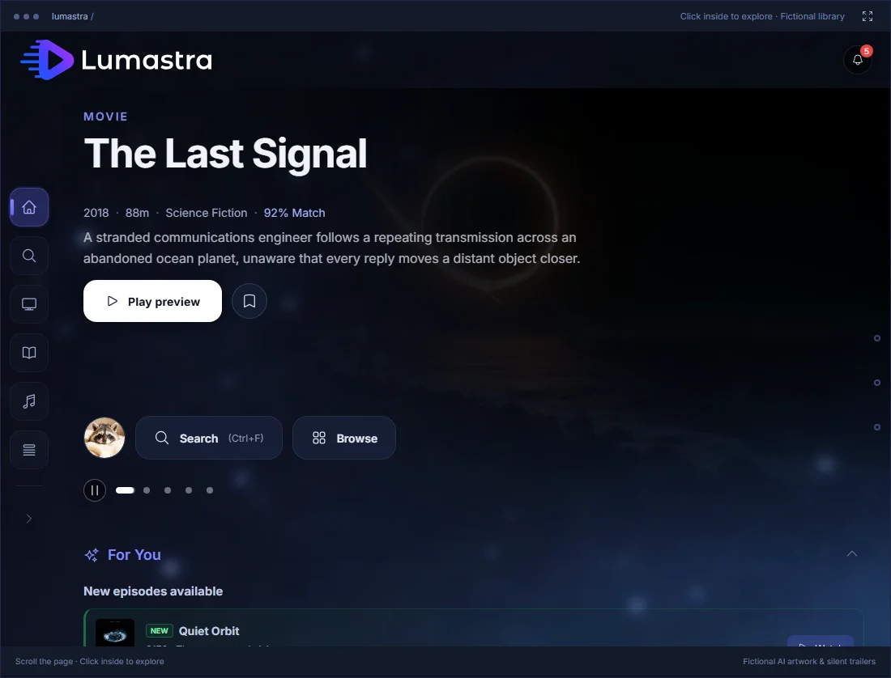

# Lumastra

[](https://github.com/Sapd/lumastra/actions/workflows/test.yml)
[](./LICENSING.md)
[](https://discord.gg/ZhaFYkuqq9)

Lumastra is a self-hosted media server for movies, series, music and audiobooks. I wrote it for my own household and run it every day. It is a one-person project, now in maintenance mode: bug fixes and security fixes, no new features. Most of the code was written with AI tools. I read and test what I merge.



## Who it is for

People who already run a homelab. Lumastra is built from several containers because the web app, the background worker (scans, transcodes, analysis) and the databases scale and fail on their own. Data lives in PostgreSQL 17 or newer with pgvector, plus two Valkey servers. It is Kubernetes-native, and Docker Compose works just as well.

Sign-in works on every device: the built-in login, any OIDC provider, or forward auth (Authentik, Authelia, oauth2-proxy). The iPhone, iPad and Apple TV apps sign in with a code you approve in a browser, so nobody types a password with the TV remote.

Your Jellyfin apps keep working. Lumastra answers the Jellyfin API under `/j`, with no Jellyfin server behind it. Tested apps: Streamyfin, Moonfin and Jellyfin Android TV. Music apps connect through the OpenSubsonic API.

## Who should use something else

If you want the simplest setup, use Jellyfin or Plex. Lumastra has no single-container mode. Compose starts five containers (web, worker, PostgreSQL, two Valkey). 8 GB of RAM is recommended. It needs its own domain, not a subpath, and the Apple apps need HTTPS with a certificate the device trusts.

If you want a large community, third-party plugins or an Android app made for Lumastra, there is none of that here.

## What works

- Movies and series, with direct play, remux or transcode chosen per client. Hardware transcoding on NVIDIA, Intel Quick Sync and VA-API.
- Music with an OpenSubsonic API, mixes and sound-alike discovery. Discovery runs on a local sonic sidecar (x86-64 only, off by default) and needs no external key. A provider key (OpenAI or Voyage AI) is only for recommendations, lyrics search and the AI assistant.
- Audiobooks, read from your Audiobookshelf server.
- Live TV from HDHomeRun, M3U and Xtream sources, with a programme guide. It is off by default and needs the stream-proxy container and a shared secret.
- Native apps for iPhone, iPad and Apple TV, with offline downloads on iPhone and iPad. They are closed source and free, through public TestFlight only.
- A web app in English and German.

## What does not

- No DVR. Live TV is for watching.
- No Android or Windows app. Use a Jellyfin app on those.
- Audiobooks need an Audiobookshelf server. Lumastra does not scan audiobook files itself.
- On arm64 there is no music BPM and mood analysis, no sonic sidecar, and no Quick Sync or VA-API.
- Browsing a very large library is slow in places.
- Expect rough edges outside my setup: Intel Quick Sync, Authentik, k3s and Apple devices.

## Quick start

Docker Compose:

```bash
curl -fsSL -o docker-compose.yml https://raw.githubusercontent.com/Sapd/lumastra/main/docker-compose.example.yml
curl -fsSL -o .env https://raw.githubusercontent.com/Sapd/lumastra/main/.env.example
# in .env, set DATABASE_PASSWORD and CACHE_PASSWORD (openssl rand -hex 24)
# mount your media folder on both the lumastra and lumastra-worker services
docker compose up -d
```

Only the two passwords are required. Lumastra generates its master key into `/config/master.key`. Open `http://localhost:3000` and follow the setup wizard. That port listens on the host only; put a reverse proxy in front for other devices.

Back up the database, the `/config` volume and the master key if you set one yourself. Without the key, stored secrets are gone. Details: [install guide](https://lumastra.org/start/quick-start/).

Kubernetes: there is a Helm chart in `deploy/helm/lumastra`. See the [Kubernetes guide](https://lumastra.org/guides/deploy-kubernetes/).

Read the [known limitations](https://lumastra.org/reference/known-limitations/) first.

## Support

I look at issues about once a week. I answer bug reports that have the version, logs and steps to reproduce, on a documented setup (the Compose example or the Helm chart). Security reports go through a private advisory, see [SECURITY.md](.github/SECURITY.md), and get priority, as do upgrade and data-loss bugs. Feature requests go to Discussions and may never get a reply. I cannot help with reverse proxies, NAS systems or identity providers I do not run, so ask other users there. Reports marked needs-info are closed after about five weeks without an answer.

## Licence

AGPL-3.0-only, including `/j` and the AI assistant. No paid parts, no licence keys. The plugin SDK and the sample plugins are Apache-2.0. See [LICENSING.md](LICENSING.md).

The Lumastra name and logo are not covered by the licence. Forks must use their own name, see [TRADEMARKS.md](TRADEMARKS.md).

## Contributing

Small fixes and bug reports are welcome. See [CONTRIBUTING.md](.github/CONTRIBUTING.md). Running it from source: [development guide](docs/dev/DEVELOPMENT.md).

If you like Lumastra, you can [sponsor it on GitHub](https://github.com/sponsors/Sapd).
