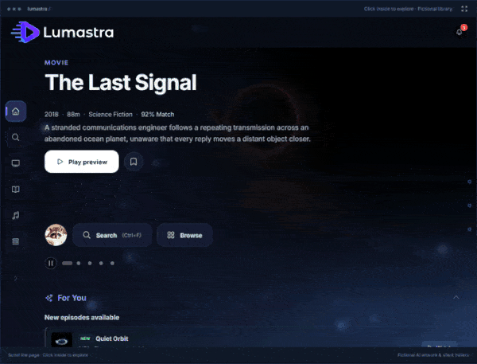
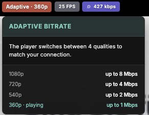
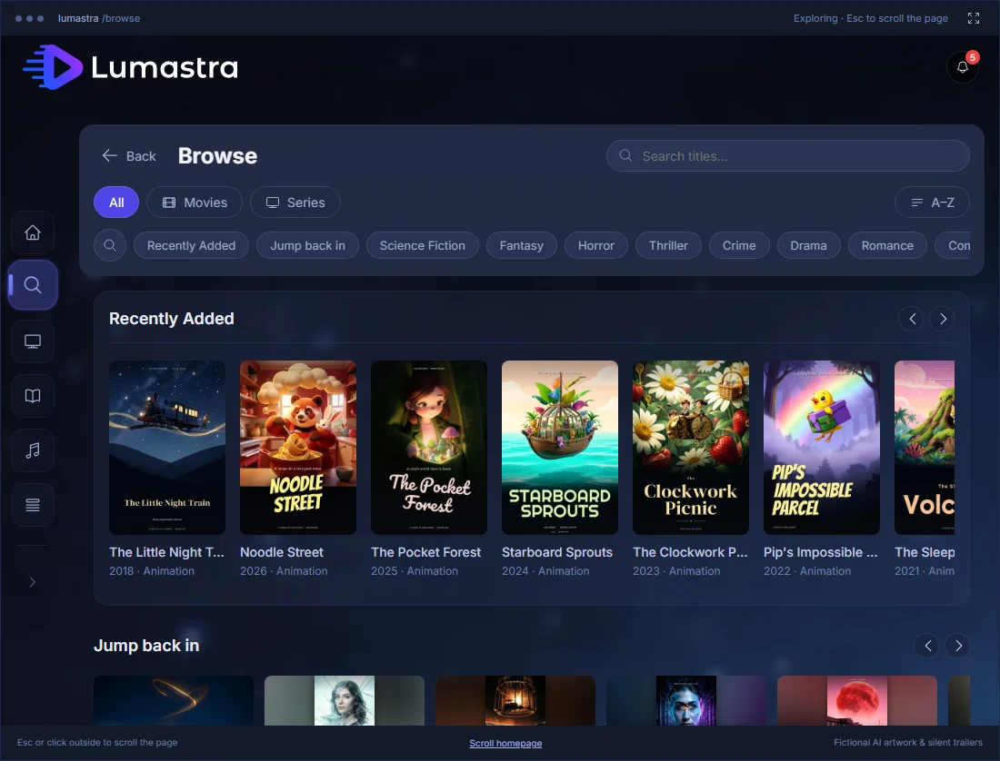
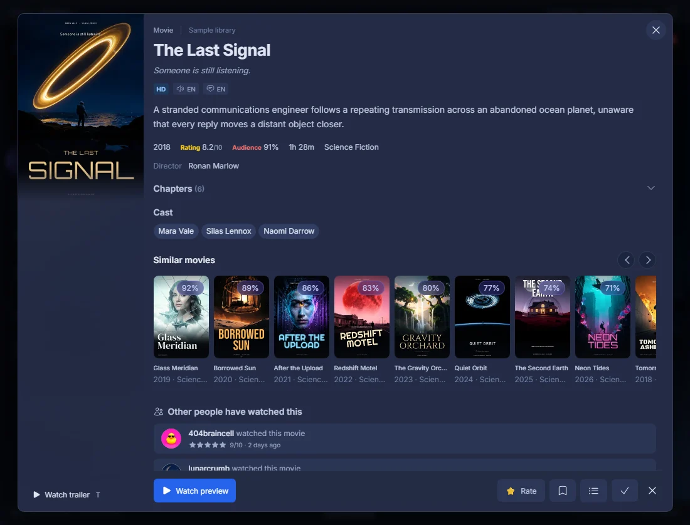
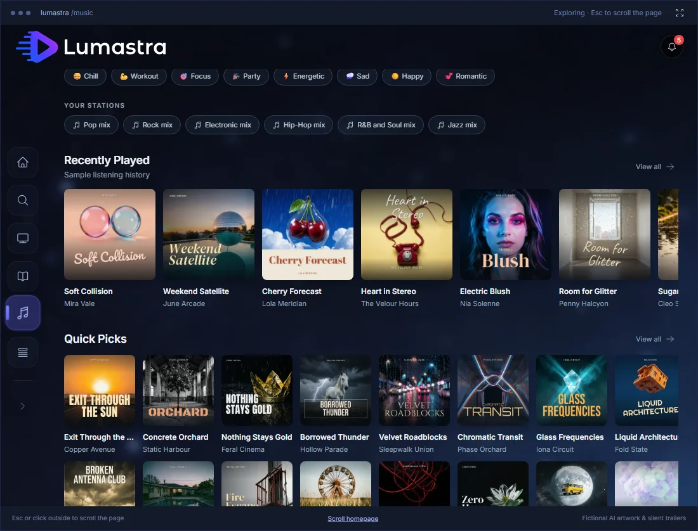
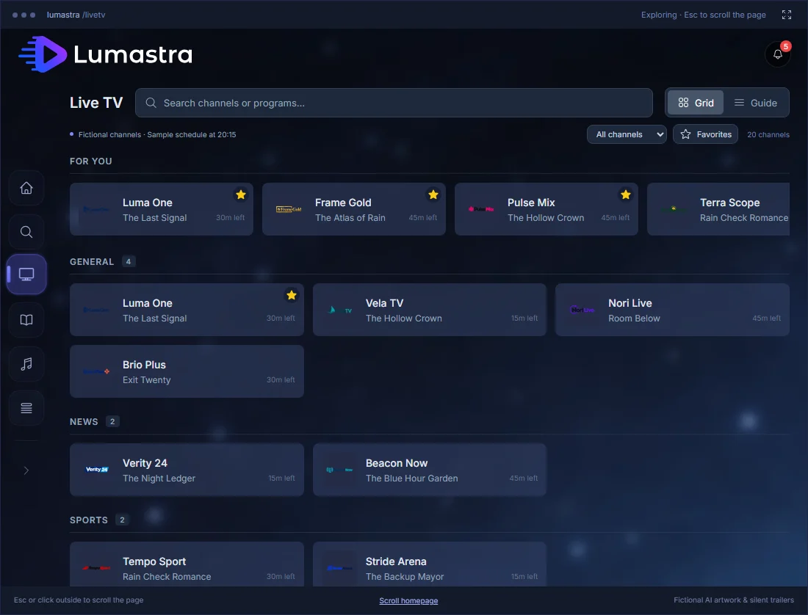

# Lumastra

[](https://github.com/Sapd/lumastra/actions/workflows/test.yml)
[](./LICENSING.md)
[](https://github.com/orgs/lumastra/packages/container/package/lumastra)
[](https://github.com/Sapd/lumastra/tags)
[](https://discord.gg/ZhaFYkuqq9)

### Self-hosted movies, series and music

Host your movies, series and music on your own hardware, with personalized discovery
and Audiobookshelf integration. I built Lumastra for myself and use it every day.

**[Website & interactive demo](https://lumastra.org/#preview)** ·
**[Quick start](https://lumastra.org/start/quick-start/)** ·
**[Documentation](https://lumastra.org/start/introduction/)** ·
**[Editions & licensing](https://lumastra.org/guides/licensing/)** ·
**[Under the hood](#under-the-hood)** ·
**[How AI is used](#how-lumastra-is-built-and-how-ai-is-used)**

> [!NOTE]
> **Lumastra is an early release (v0.1).** It runs our own libraries every day, but expect
> rough edges and bugs, especially on hardware and setups we haven't tested. Back up your
> `/config` volume and database, and please [report what breaks](https://github.com/Sapd/lumastra/issues).
> The Apple apps have their own version numbers (1.0.1 at launch), and they are just as early.
> See [known limitations](https://lumastra.org/reference/known-limitations/) before you deploy.

Lumastra is created and maintained by **Denis Arnst (Sapd)**. You might know my work from
[HeadsetControl](https://github.com/Sapd/HeadsetControl), or from
[Audiobookshelf](https://github.com/advplyr/audiobookshelf), where I wrote most of the
OpenID Connect (SSO) support. The official repository is
[github.com/Sapd/lumastra](https://github.com/Sapd/lumastra), and official images are published as
`ghcr.io/lumastra/lumastra`. Forks are welcome under the license, but must use their own name
([`TRADEMARKS.md`](./TRADEMARKS.md)).

**Project status:** Lumastra is for power users who like to tune their setup. It has
more moving parts than Jellyfin: PostgreSQL, Valkey, optional AI keys and more settings.
For minimal setup, Jellyfin or Plex may suit you better. Proper SSO and security
were priorities from the start.

Until 1.0, I'm focusing on bugs and polish rather than new features. Ideas are welcome
in [Discussions](https://github.com/Sapd/lumastra/discussions/categories/features).
I maintain Lumastra because I use it myself. If I can't keep up the pace of the first
months, replies and fixes may take a while; please be patient. If issues grow, I may
split features into a supported core and areas maintained as time allows.

[](https://lumastra.org/#preview)

_Demo with fictional AI-generated media and a silent sample trailer. Lumastra
supplies no media or TV subscriptions; connect your own sources._

Use Lumastra only with media and sources you have the rights to: your own copies,
public-domain works, or services you're licensed to use.

## What Lumastra does well

- **Single sign-on that works everywhere.** Use Authentik, Authelia, Keycloak or any OIDC
  provider, including on the Apple TV, with no passwords typed on the remote. SSO is part
  of the free core.
- **Native apps** for iPhone, iPad and Apple TV, written in Swift.
- **Watch Together** between the web app and the Apple TV app.
- **Music, all built in:** sonic analysis, a smart queue, DJ crossfades, automatic mixes and
  OpenSubsonic, in the same server as your films. No separate Subsonic server or extra tools needed.
- **Subtitles without burn-in**, including styled ASS/SSA and PGS/VobSub.
- **Recommendations beyond what you own**, plus search by what a film is about.
- **Live TV built for reliable viewing:** shared upstream streams, automatic backup-feed
  failover and optional GPU adaptive quality, with end-to-end playback and failure tests.
- **Media management with review built in:** traceable artwork choices, previewed repairs,
  file-health evidence and episode mappings that match the files you actually have.

## Full feature list

<details>
<summary><b>Movies and series</b>: recommendations, semantic search, calendar, episode matching</summary>

- **Recommendations:** For You shelves, mood picks and similar titles, including titles
  outside your collection.
- **Semantic search:** search by what a film is about (needs your own AI provider key).
- **Release calendar:** upcoming episodes and releases for what's in your library.
- **Multi-episode files** (`S01E01-E02`) link to every episode they contain.
- **Episode ordering:** matches the layout on disk, including DVD and absolute ordering.
- **More than entertainment:** library types for home videos, training and educational
  content.
- **AI assistant:** ask for something to watch in plain language, with your own AI provider
  key. Part of the supporter tier.

</details>

<details>
<summary><b>Playback</b>: direct play, remux or transcode per device; hardware transcoding; subtitles without burn-in</summary>

- The server decides per client whether to play a file directly, remux it or transcode it,
  based on codecs, HDR and subtitles.
  ([Playback decisions](https://lumastra.org/architecture/playback-decisions/))
- **Hardware transcoding** is tested most on **Intel** (Quick Sync / VA-API), less on
  **NVIDIA** (NVENC) and least on **AMD**. All three should work, but expect bugs outside
  Intel for now. Software transcoding always works as a fallback.
- **Subtitles without burn-in:** styled ASS/SSA and PGS/VobSub overlay the video,
  preserving HDR and avoiding a video re-encode. Browsers use
  [AkariSub](https://github.com/altqx/akarisub) (libass for the web) and
  [libbitsub](https://github.com/altqx/libbitsub); Apple apps receive server-rendered
  pictures with timing data. Burn-in remains available for clients that need it.
- Trickplay thumbnails for seeking, chapters, and gapless audio.

</details>

<details>
<summary><b>Music</b>, all built in: sonic analysis, smart queue, DJ crossfades, auto mixes, OpenSubsonic</summary>

- **Audio analysis:** tempo, key, energy and mood, built into the x86-64 image; an optional
  sonic sidecar adds sound similarity ("sounds like").
- **Smart queue:** keeps going with tracks that fit, in an order that flows, with **DJ
  crossfades** between them.
- **Mixes and collections** built on their own, per genre and by sound.
- **Song Paths** (a smooth path between two songs), a **Music Map** of your library, and
  **search by sound** ("calm solo piano") or by the meaning of lyrics.
- **Careful tag reading**, so albums, discs and compilations come out in the right order.
- **OpenSubsonic compatibility**, so your favourite music apps keep working. No separate
  Subsonic server or smart-playlist scripts needed.
- ([Music discovery](https://lumastra.org/guides/music-discovery/))

</details>

<details>
<summary><b>Audiobooks and books</b>: Audiobookshelf integration, Kavita search</summary>

- Connect Audiobookshelf, then browse and listen in the web app and the iPhone, iPad and
  Apple TV apps, with progress synced back to Audiobookshelf.
- In the web player, see where others on your server are in the same book.
- Search your Kavita books from Lumastra and open them in Kavita.

</details>

<details>
<summary><b>Live TV</b>: built and tested for reliable viewing</summary>

- **Your sources, one guide:** M3U, Xtream or HDHomeRun sources you're licensed to receive,
  with automatic channel grouping, numbering and a programme guide.
- **Shared streams:** the default Rust proxy shares one upstream connection among viewers
  of the same channel; viewer heartbeats manage active sessions.
- **Backup feeds:** automatic failover tries alternate feeds. If none work, the player
  shows a failure with a choice to try another channel.
- **Adaptive quality:** optional GPU encoding from 1080p down to 360p lets the player
  switch quality to match each viewer's connection. Tested with an Intel Arc A380.
- **Simple mode:** large controls, a personal numbered channel list, now/next information
  and an optional helper PIN for viewers who want a familiar TV screen.
- **End-to-end testing:** a synthetic provider exercises real imports, decoded playback,
  stream limits and upstream failures through the app and proxy.

See the [Live TV guide](https://lumastra.org/guides/live-tv/),
[simple mode](https://lumastra.org/guides/live-tv-simple-mode/) and
[proxy architecture](https://lumastra.org/architecture/live-tv/).
Recording (DVR) isn't available yet.



</details>

<details>
<summary><b>Media management</b>: traceable artwork, reviewed repairs and file-health evidence</summary>

- **Artwork with provenance:** inspect image candidates and their recorded sources,
  choose the image to use and protect a curated selection. Unknown origins stay explicit.
- **Reviewed identity repairs:** preview a two-episode TMDB ID exchange before applying it;
  internal episode IDs, file links and watch data stay attached to their existing episodes.
- **Album merges with a plan:** review the kept album, tracks, artwork and user-data
  policies before confirming. Duplicate track candidates keep their separate files.
- **Episodes that match your files:** review boundaries in combined multi-episode files.
  Join split episodes into one file on disk before importing them.
- **File-health evidence:** inspect stream and audio-tail measurements, run a bounded
  recheck and keep warnings when the result is inconclusive.
- **Quarantine for uncertain matches:** compare historical proposals with current files
  and metadata, then review eligible changes before accepting a batch.

See [media enrichment](https://lumastra.org/guides/media-enrichment/),
[administration](https://lumastra.org/guides/administration/) and
[library troubleshooting](https://lumastra.org/guides/library-troubleshooting/).

</details>

<details>
<summary><b>Together</b>: Watch Together, ratings and reviews, who watched what</summary>

- **Watch Together:** synchronized sessions between the web app and the Apple TV app.
  Start on the TV and friends join from a browser. (The iPhone and iPad app can't join
  sessions yet.)
- Shared ratings, reviews and watch activity, with per-user privacy controls.
- **Trakt and MyAnimeList sync:** each user can link their own Trakt account (history in
  either or both directions), and watch progress goes to MyAnimeList automatically. Optional
  progress sync with an existing Jellyfin server works alongside.

</details>

<details>
<summary><b>Apps and clients</b>: iPhone, iPad, Apple TV, web app, Jellyfin and Subsonic clients</summary>

- Native iPhone and iPad apps with offline downloads, and an Apple TV app with music,
  audiobooks and Top Shelf.
- An installable web app for desktop and mobile.
- Jellyfin-compatible clients (such as Streamyfin) and (Open)Subsonic music apps connect
  directly. No Jellyfin server needed.
- See [Watch and listen on your devices](#watch-and-listen-on-your-devices) below.

</details>

<details>
<summary><b>Sign-in and security</b>: single sign-on everywhere, per-user data isolation, scoped tokens</summary>

- **Single sign-on:** OIDC and reverse-proxy forward authentication are fully supported
  everywhere: web, iPhone, iPad, Apple TV and the API.
- **Built-in accounts:** username and password, on their own or alongside single sign-on.
  The first-run wizard creates your admin account.
- **OAuth 2.0 device flow** for native apps: approve a code through your server's login,
  with refreshable, revocable tokens. No TV passwords or pairing that bypasses SSO.
- **Your data is yours:** ratings, playlists, watch state, watchlists and devices belong to
  their user. Other users can't read or change them, and admin rights are separate from
  everyday use.
- **Every route has an explicit access rule** (public, signed-in user, admin, or a scoped
  token). A test fails when a route has no rule, or when a rule gets looser without a
  written reason.
- **Checks per item, not just per page:** a title from a library you can't access answers
  "not found", so its existence doesn't leak.
- **Narrow credentials:** scoped, revocable tokens for apps and the API, short-lived
  playback grants instead of long-lived stream links, and read-only service tokens for
  integrations.
- **Signed plugins:** the admin decides which signing keys to trust.
- **Reviewed before releases,** with a private disclosure process
  ([`SECURITY.md`](.github/SECURITY.md)).

</details>

<details>
<summary><b>API, plugins and operations</b>: documented API, signed plugins, task system, replicas</summary>

- **`/api/v1`** is documented, versioned and described by an
  [OpenAPI spec](docs/api/openapi.yaml), with scoped personal access tokens and the same
  OAuth device flow for your own players. See the
  [developer docs](https://lumastra.org/developers/api/).
- **Plugins** for media sources, providers, subtitles, lyrics, tasks, watch sync and
  authentication, with an SDK for your own integrations.
- A tracked background pipeline, an admin task system and health monitoring, and web and
  worker replicas. More in [Under the hood](#under-the-hood).
- **Deployment:** Docker Compose, or Kubernetes with a Helm chart (beta).

</details>

<table>
  <tr>
    <td width="50%"></td>
    <td width="50%"></td>
  </tr>
  <tr>
    <td align="center"><sub>Browse your collection</sub></td>
    <td align="center"><sub>Find your next watch</sub></td>
  </tr>
  <tr>
    <td></td>
    <td></td>
  </tr>
  <tr>
    <td align="center"><sub>Discover music</sub></td>
    <td align="center"><sub>Explore Live TV</sub></td>
  </tr>
</table>

[Try the interactive demo](https://lumastra.org/#preview) to see a fully configured
interface with metadata, artwork, trailers and recommendations, without a server login.
It simulates selected workflows; it isn't a hosted media service.
[View the Home screenshot](docs/assets/screenshots/home.webp).

## Watch and listen on your devices

| Client                                | What to expect                                                                                                                                                                                                          |
| ------------------------------------- | ----------------------------------------------------------------------------------------------------------------------------------------------------------------------------------------------------------------------- |
| **Native iPhone and iPad apps**       | Built for Lumastra, including offline downloads. Available through [public TestFlight](https://testflight.apple.com/join/m8EUbgJQ).                                                                                     |
| **Native Apple TV app**               | Lumastra on the big screen, with music, audiobooks, Watch Together and Top Shelf. Available through [public TestFlight](https://testflight.apple.com/join/QCfrcmZn).                                                    |
| **Web app**                           | Browse and play in your browser; install as a PWA on desktop or mobile.                                                                                                                                                 |
| **Jellyfin-compatible clients**       | Connect clients such as Jellyfin and Streamyfin directly to Lumastra through its compatibility API. No Jellyfin server is required. Two concurrent bridge streams are free; additional streams are a supporter feature. |
| **Subsonic-compatible music clients** | Connect your preferred music app through the (Open)Subsonic API, included in the free core.                                                                                                                             |

See [connecting third-party apps](https://lumastra.org/using/third-party-players/)
for setup. Native-app downloads are distinct from the web app, which does not
currently offer offline downloads. Live TV recording (DVR) is not available yet.

The iPhone, iPad and Apple TV apps need your server on **HTTPS with a certificate the
device trusts** (for example a reverse proxy with Let's Encrypt). Plain HTTP and
self-signed certificates don't work. They sign in through the **Public API** setting
(Admin → Settings), which is on by default.

## What you need, and what is optional

Lumastra runs as a **standalone media server for movies, series and music**.
You do not need a Jellyfin server to use it. Every integration is optional and is skipped
quietly when it isn't configured, but some make a big difference.

**Required**

- **PostgreSQL 17+ with pgvector** and **Valkey** (or Redis). The example Docker Compose
  file sets up both.

**For the full experience**

| What                                                                  | What you get                                                                                                      | How                                                                                                                                                                                  |
| --------------------------------------------------------------------- | ----------------------------------------------------------------------------------------------------------------- | ------------------------------------------------------------------------------------------------------------------------------------------------------------------------------------ |
| **TMDB API key** (free)                                               | Metadata, posters and backdrops, search and discovery. Without it, titles only have their file names.             | `TMDB_API_KEY` or the setup wizard                                                                                                                                                   |
| **Embeddings key** (OpenAI or Voyage AI, paid per use, usually cheap) | Recommendations, "For You", mood picks and semantic search. Also needed for the music features below.             | `OPENAI_API_KEY` or `VOYAGE_API_KEY`                                                                                                                                                 |
| **MDBList API key** (free account)                                    | The Trending and Popular shows rows, and keyword tags that make recommendations noticeably better.                | `MDBLIST_API_KEY`                                                                                                                                                                    |
| **Sonic embedder sidecar** (x86-64; a GPU helps but isn't needed)     | Music by sound: sound-alike tracks, a smart queue that follows the sound, mixes and collections, search by sound. | `docker compose --profile sonic up -d`, then `FEATURE_MUSIC_SONIC` and the per-feature flags ([Music discovery](https://lumastra.org/guides/music-discovery/#enabling-the-features)) |
| **AcoustID API key** (free)                                           | Identifies your music by its sound, for accurate matches in MusicBrainz.                                          | `ACOUSTID_API_KEY`                                                                                                                                                                   |
| **HTTPS with a trusted certificate**                                  | Needed by the iPhone, iPad and Apple TV apps.                                                                     | your reverse proxy                                                                                                                                                                   |

Tempo, key and energy analysis for DJ crossfades and mood picks is built into the image on
x86-64 and needs no setup.

**Optional**

| Integration                                             | Purpose                                                                                           |
| ------------------------------------------------------- | ------------------------------------------------------------------------------------------------- |
| **Audiobookshelf**                                      | Required for the audiobook library and playback.                                                  |
| **Identity provider** (OIDC or forward auth)            | Single sign-on; built-in accounts work without one.                                               |
| **Kavita**                                              | Search books in Lumastra, then open them in Kavita.                                               |
| **Jellyfin**                                            | Watch-progress sync with an existing Jellyfin server; separate from the client compatibility API. |
| **Sonarr / Radarr**                                     | Release calendar for your series and movies.                                                      |
| **Request service** (Seerr)                             | Lets users ask the admin to add a title.                                                          |
| **Last.fm, Discogs, AniDB**                             | Music popularity, artist details and anime metadata.                                              |
| **Chat assistant key** (OpenAI-compatible or Anthropic) | The AI chat assistant (a supporter feature, free during early access).                            |

The full list, with every setting, is in
[Optional integrations](https://lumastra.org/guides/integrations/).

You control the server and which integrations it uses. Relevant metadata or
prompts may be sent to providers you configure; self-hosting does not make an
external AI or metadata service local.

## Free core and supporter features

| Feature                           | Licence                                   | Availability                                                           |
| --------------------------------- | ----------------------------------------- | ---------------------------------------------------------------------- |
| Movies & series                   | AGPL-3.0-only                             | Library management, playback and hardware transcoding                  |
| Music                             | AGPL-3.0-only                             | Playback, mixes and music discovery                                    |
| Audiobooks via Audiobookshelf     | AGPL-3.0-only (Lumastra integration)      | Requires an Audiobookshelf server                                      |
| Live TV                           | AGPL-3.0-only                             | Programme guide and playback; no DVR                                   |
| Jellyfin app compatibility (`/j`) | Source-available proprietary              | Two concurrent streams free per server; more with supporter access     |
| Subsonic / OpenSubsonic           | AGPL-3.0-only                             | Connect compatible music apps                                          |
| Watch Together                    | AGPL-3.0-only                             | Synchronized sessions between web and Apple TV                         |
| AI recommendations                | AGPL-3.0-only                             | Recommendations and semantic search; configured providers may charge   |
| AI chat assistant                 | Source-available proprietary              | Supporter feature (free during early access); needs an AI provider key |
| Apple apps                        | Closed source                             | iPhone, iPad and Apple TV; separate from the server                    |
| Plugins                           | AGPL-3.0-only; SDK and samples Apache-2.0 | Bundled plugins are AGPL; third-party plugins have their own licences  |

The `/j` Jellyfin compatibility surface and AI chat assistant ship in this repository as
**source-available, licence-gated proprietary components** under
[`LicenseRef-Lumastra-Proprietary`](./LICENSES/LicenseRef-Lumastra-Proprietary.txt).
Recommendations and their shared data/query layer remain AGPL; see
[`LICENSING.md` §3.1](./LICENSING.md#31-proprietary-tier--licenseref-lumastra-proprietary) and
[§3a](./LICENSING.md#3a-what-stays-agpl-and-the-one-directional-invariant).

The **AGPL-3.0-only core is free**. SSO will never be a paid feature.

The **AI chat assistant** and **additional simultaneous streams through the
Jellyfin-compatible client bridge** are source-available supporter features.
Two bridge streams at a time stay free for the whole server, whoever is watching.
The web app and the iPhone, iPad and Apple TV apps don't use the bridge, so they
aren't limited. Supporter features are currently free during early access; pricing
has not been published. AI provider credentials and usage are separate.

### Why a few parts are source-available

The free core includes hardware transcoding, Live TV and remote access. The `/j`
bridge takes extra maintenance to follow another project's API; I'd rather new apps
use the fully open, documented `/api/v1`. Donations rarely cover costs, and I hope
supporter features help offset development and hosting.

**The iPhone, iPad and Apple TV apps are closed source.** They're free for now; some
features, such as offline downloads, will probably become paid later. They talk to the
server only through the same open `/api/v1` any other app can use. What went into
building them is in the developer docs:
[building a player](https://lumastra.org/developers/building-a-player/) (streaming, state,
subtitles), [Watch Together](https://lumastra.org/developers/watch-together/),
[OAuth sign-in](https://lumastra.org/developers/oauth-clients/),
[offline downloads](https://lumastra.org/developers/offline-downloads/), and music,
audiobook and Live TV playback. The LGPL libraries they include are published at
[Lumastra/lgpl-source](https://github.com/Lumastra/lgpl-source).

What's open source today stays open source and maintained; I won't move existing
features behind a license. Most future features will be open source too. The likely
exception is recording (DVR).

Contributions need a Contributor License Agreement so I can also offer a commercial
license to companies that can't use the AGPL, and the supporter features. Many well-known
projects do the same, including Kubernetes, the Apache Software Foundation projects, Python
and Go. You keep the copyright to your code, contributions to the open-source core stay
available under the AGPL (or another open-source license), and anyone can fork the core under the AGPL at any time.

For licensing or CLA questions, contact <git@sapd.eu>.

See [editions and licensing](https://lumastra.org/guides/licensing/) for the
current offering and [LICENSING.md](LICENSING.md) for the source-code boundaries.

## Quick start

Lumastra runs alongside **PostgreSQL with pgvector** and **Valkey**; the reference
compose file provisions PostgreSQL 18 and Valkey.

```bash
mkdir lumastra && cd lumastra
curl -fsSL -o docker-compose.yml https://raw.githubusercontent.com/Sapd/lumastra/main/docker-compose.example.yml
curl -fsSL -o .env https://raw.githubusercontent.com/Sapd/lumastra/main/.env.example
```

The secrets file must be named exactly `.env`, because compose reads its variables
from it. You only need to clone the repository if you want to build from source.

Generate the three secrets straight into `.env` (copy-paste; macOS and Linux):

```bash
sed -i.bak \
  -e "s|^DATABASE_PASSWORD=.*|DATABASE_PASSWORD=$(openssl rand -hex 24)|" \
  -e "s|^CACHE_PASSWORD=.*|CACHE_PASSWORD=$(openssl rand -hex 24)|" \
  -e "s|^# LUMASTRA_MASTER_KEY=.*|LUMASTRA_MASTER_KEY=$(openssl rand -hex 32)|" \
  .env && rm -f .env.bak
```

(Windows without WSL: set those three lines in `.env` by hand; hex values only, since the
passwords end up inside connection URLs.) `LUMASTRA_MASTER_KEY` encrypts every secret
Lumastra stores and, unless you set `JWT_SECRET`, signs every login token: back it up.

In `docker-compose.yml`, uncomment the media line under the `lumastra` service's
`volumes:` and point it at your media folder (`- /path/to/media:/data/media:ro`).
Then:

```bash
docker compose up -d
```

Open <http://localhost:3000> and follow the setup wizard. Full walkthrough, including
what to persist and why: **[lumastra.org/start/quick-start](https://lumastra.org/start/quick-start/)**.

Next: put it behind HTTPS. The iPhone, iPad and Apple TV apps need it. See the
**[reverse proxy guide](https://lumastra.org/guides/reverse-proxy/)** for Caddy, nginx,
Traefik and Nginx Proxy Manager.

Image tags on `ghcr.io/lumastra/lumastra`: `:stable` (= `:latest`) is the newest release, and
`:X.Y.Z` / `:X.Y` pin one; all of these are published for `linux/amd64` and `linux/arm64`.
`:edge` follows every commit to `main` and is `linux/amd64` only. Before you commit
to a host, read **[Known limitations](https://lumastra.org/reference/known-limitations/)**.
It covers arm64 gaps, CPU requirements, scaling rules and the `/config` volume you
must never lose.

## Documentation

| You want to…                           | Go to                                                                                                                          |
| -------------------------------------- | ------------------------------------------------------------------------------------------------------------------------------ |
| Install, configure or deploy           | [Quick start](https://lumastra.org/start/quick-start/) · [Deployment](https://lumastra.org/guides/deployment/)                 |
| See every setting                      | [Environment variables](https://lumastra.org/reference/environment-variables/)                                                 |
| Set up sign-in and SSO                 | [Authentication](https://lumastra.org/guides/authentication/)                                                                  |
| Administer a running server            | [Administration](https://lumastra.org/guides/administration/)                                                                  |
| Connect a TV app or third-party client | [Connecting third-party apps](https://lumastra.org/using/third-party-players/)                                                 |
| Build against the API                  | [API & tokens](https://lumastra.org/developers/api/) · [Building a player](https://lumastra.org/developers/building-a-player/) |
| Write a plugin                         | [Writing a plugin](https://lumastra.org/developers/plugins/)                                                                   |
| Contribute to this repository          | [CONTRIBUTING.md](.github/CONTRIBUTING.md) · [docs/README.md](docs/README.md)                                                  |
| Fix or add documentation               | [Sapd/lumastra-docs](https://github.com/Sapd/lumastra-docs) (every page has an "Edit page" link)                               |

The interactive OpenAPI reference is at [lumastra.org/reference](https://lumastra.org/reference/);
the same long-form API notes ship in this repo at [`docs/api/API.md`](docs/api/API.md) and
are served by every instance at `/api-docs` and `/llms.txt`.

## Under the hood

- **Tracked processing pipeline:** 72 built-in tasks cover scanning, metadata, artwork,
  analysis and embeddings. Crash recovery, watchdogs and circuit breakers handle
  failed runs and services. ([Task system](https://lumastra.org/architecture/task-system/))
- **Separate web and worker roles:** web replicas serve requests and submit work;
  exactly one lean TypeScript worker runs existing tasks/plugins and supervises a
  Rust file-watcher child in the same container. BullMQ uses persistent noeviction
  Valkey for task/shared coordination, alongside a separate evictable cache.
  Valkey heartbeats let another web process take over a playback session when its
  server goes away.
- **Playback decisions** use client codecs, HDR, subtitles, hardware encoder detection
  and device profiles. ([Playback decisions](https://lumastra.org/architecture/playback-decisions/))
- **HLS remuxing** repackages audio and video without re-encoding, supporting reliable
  seeking and track switching on Apple devices, browsers and other clients. Avoiding
  unnecessary video re-encoding matters more than direct play at any cost.
- **Cached image subtitles:** the server decodes PGS/VobSub once and sends pictures,
  avoiding client decoders and video re-encoding.
- **Live TV stream proxy:** automatic backup-feed grouping, failover and category numbering.
  ([Live TV](https://lumastra.org/architecture/live-tv/))
- **Signed plugins:** Ed25519-signed repositories use a built-in trusted key;
  unsigned or tampered manifests are refused.
- **Versioned public API:** more than 300 `/api/v1` operations in an OpenAPI spec,
  checked against the code in CI.
- **License boundaries enforced in CI:** the open core never imports source-available
  modules; every source file carries its license header.

[Architecture decisions](https://lumastra.org/developers/architecture-decisions/)
explain the choices and tradeoffs.

## How Lumastra is built, and how AI is used

I'm the sole developer and use Claude Code daily for code drafts, fixes, tests,
documentation and design discussions. Architecture, data models, security-sensitive
code and merge decisions remain mine. I read what lands and don't merge code I
don't understand.

AI-assisted security reviews helped prepare this release. I verified each finding
against the code and measured fixes on a test instance, which caught issues the reviews
missed. More than 2,500 test files and hands-on testing with friends' and my own
libraries provide further checks.

More in [the Lumastra story](https://lumastra.org/about/story/).

AI-assisted contributions are welcome, with the same rules I follow myself:

- **Tested end to end, no exceptions.** Every change, AI-assisted or not, must have been
  run on a real Lumastra instance and seen working, not only pass the tests.
- **AI code review on every PR.** Every pull request gets an AI review before it is merged,
  and each finding needs an answer.
- **Experience for the big and the tricky.** Bigger features, and changes in complicated
  areas such as authentication, playback or the task system, need real development
  experience. Smaller fixes are welcome from anyone.

- **No vibe-coded PRs.** Code that wasn't fully tested, or that the author can't explain,
  isn't accepted.
- **Zero tolerance for farming and copying.** Opening PRs just for the sake of it, or
  submitting someone else's code, translations or other work as your own, gets you banned
  without warning.

Details in [CONTRIBUTING-AI.md](.github/CONTRIBUTING-AI.md).

## Community and support

[](https://discord.gg/ZhaFYkuqq9)

Join the [Lumastra Discord](https://discord.gg/ZhaFYkuqq9) to chat with other users, introduce yourself and get
informal help in the `#help` forum (one post per question). Personal instance or library
showcases are not part of the community. Use the destinations below for lasting support
answers, reports and proposals so they remain searchable and maintainers can track them. A
Discord conversation does not replace a GitHub report or an accepted feature discussion.

| You want to…                                                                  | Go to                                                                                                                                                                                          |
| ----------------------------------------------------------------------------- | ---------------------------------------------------------------------------------------------------------------------------------------------------------------------------------------------- |
| Find installation, configuration or operating instructions                    | [lumastra.org](https://lumastra.org)                                                                                                                                                           |
| Chat with other users or get quick, informal help                             | [Discord](https://discord.gg/ZhaFYkuqq9)                                                                                                                                                       |
| Ask for help with installation, deployment, playback, clients or integrations | [GitHub Discussions](https://github.com/Sapd/lumastra/discussions): choose the matching category; use [Q&A](https://github.com/Sapd/lumastra/discussions/categories/q-a) for general questions |
| Report a reproducible bug, playback problem or documentation issue            | [GitHub issue forms](https://github.com/Sapd/lumastra/issues/new/choose)                                                                                                                       |
| Propose a feature                                                             | [Discussions → Features](https://github.com/Sapd/lumastra/discussions/categories/features); maintainers open tracking issues for accepted proposals                                            |
| Report a security vulnerability                                               | Privately, following [SECURITY.md](.github/SECURITY.md); never in a public channel                                                                                                             |
| Report a Code of Conduct violation                                            | Privately to <git@sapd.eu>, following the [Code of Conduct](.github/CODE_OF_CONDUCT.md#reporting)                                                                                              |

The [Code of Conduct](.github/CODE_OF_CONDUCT.md) applies on GitHub and Discord, including the
content rules: no references to pirated content, redact sensitive information before posting,
and verify reports yourself. Contribution requirements and project policies live in this
repository; user documentation lives on the website.

## Support the project

The easiest way to help: ⭐ star this repository, and tell others about Lumastra. If you want to
do more, you can [sponsor the development on GitHub](https://github.com/sponsors/Sapd).

## Contributing

Contributions are welcome. [`CONTRIBUTING.md`](.github/CONTRIBUTING.md) covers the development
setup, tests, code style and the pull-request process, including that feature ideas go
through [Discussions](https://github.com/Sapd/lumastra/discussions/categories/features) before
any code, and that AI-assisted work is welcome with its extent and model disclosed; contributions are accepted under
the [Contributor License Agreement](.github/CLA.md), which a bot will ask you to sign on your
first pull request. Please also read the [Code of Conduct](.github/CODE_OF_CONDUCT.md).

## Security

Found a vulnerability? Please **do not** open a public issue. Follow the responsible
disclosure process in [`SECURITY.md`](.github/SECURITY.md).

## Thanks

Lumastra stands on a lot of open-source work. A few projects deserve a special mention:

- **[jellyfin-ffmpeg](https://github.com/jellyfin/jellyfin-ffmpeg)**: Lumastra's transcoding
  depends on it heavily, and it's really well done. Its developer(s) are also very friendly
  and patiently answered my questions in the past when I used Jellyfin.
- **[Audiobookshelf](https://github.com/advplyr/audiobookshelf)**: Lumastra's audiobook
  support is built on it. Its owner [@advplyr](https://github.com/advplyr) is really friendly
  and a pleasure to work with, which I got to see first-hand while writing its SSO support,
  and its community is exceptionally welcoming too.
- **[AkariSub](https://github.com/altqx/akarisub)** and
  **[libbitsub](https://github.com/altqx/libbitsub)**: render styled ASS/SSA and image-based
  (PGS/VobSub) subtitles in the browser. I contributed a few things to AkariSub, and working
  with their author was a pleasure.
- **[TMDB](https://www.themoviedb.org)** and **[MusicBrainz](https://musicbrainz.org)**: almost
  all metadata and artwork comes from these community-built databases. Without them there
  would be no posters, descriptions or music data.
- **[PostgreSQL](https://www.postgresql.org)** and **[pgvector](https://github.com/pgvector/pgvector)**:
  everything Lumastra stores lives in PostgreSQL, and the recommendations run on pgvector,
  without any extra search infrastructure.
- **[Svelte](https://svelte.dev)** and SvelteKit: the web app is built on them, and I'm a big
  fan.

The full list of third-party components and their licenses is in
[`THIRD-PARTY-NOTICES.md`](./THIRD-PARTY-NOTICES.md).

## License

Lumastra is **open core**. The core is **GNU AGPL-3.0-only** ([`LICENSE`](./LICENSE)).
The plugin SDK (`packages/@sapd/lumastra-plugin-sdk*`) and sample plugins
(`examples/plugins/`) are **Apache-2.0** ([`LICENSING.md` §4](./LICENSING.md#4-plugin-sdk-and-sample-plugin-license)).

The same AGPL core is also available under a **separate, negotiated commercial license**
without the AGPL's copyleft and source-disclosure obligations, including §13. This requires
an individual agreement; it is not a free alternative licence choice. Contact <git@sapd.eu>;
see [`LICENSING.md` §2](./LICENSING.md#2-commercial-license-also-available-dual-licensing).

The `/j` compatibility API and AI assistant are **source-available, licence-gated proprietary
components**, governed by their [own terms](./LICENSES/LicenseRef-Lumastra-Proprietary.txt).
The separate **Enterprise tier** (LMS, compliance reporting and product showcase) is excluded
from this public distribution; its source is supplied only to licensees under a negotiated
agreement ([`LICENSING.md` §3.2](./LICENSING.md#32-enterprise-tier--licenseref-lumastra-enterprise-not-in-this-repository)).

The Lumastra name, logos and brand assets have separate trademark and asset terms; see
[`TRADEMARKS.md`](./TRADEMARKS.md) and [`LICENSING.md` §6](./LICENSING.md#6-trademark--affiliation).
Forks must use their own name and branding.

Every source file carries an `SPDX-License-Identifier` header indicating its license.
Contributions are accepted under a Contributor License Agreement (CLA) that preserves the
project's ability to offer the commercial license.
